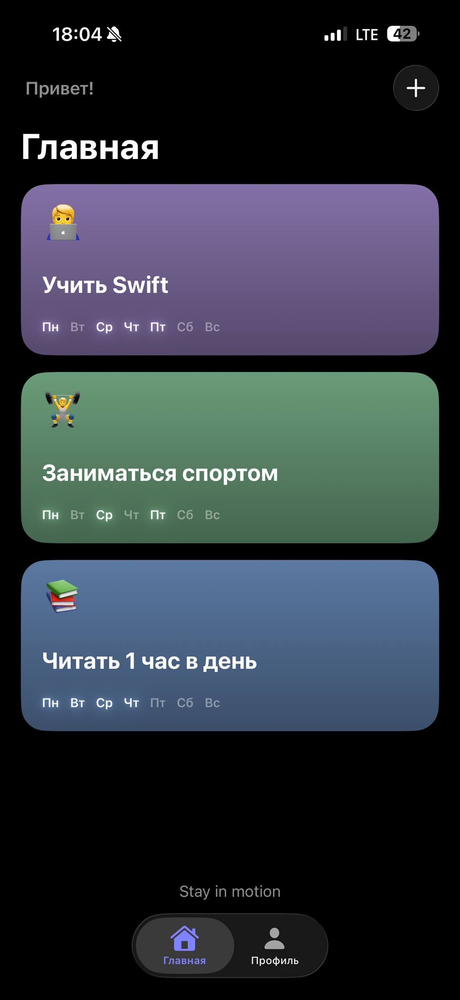
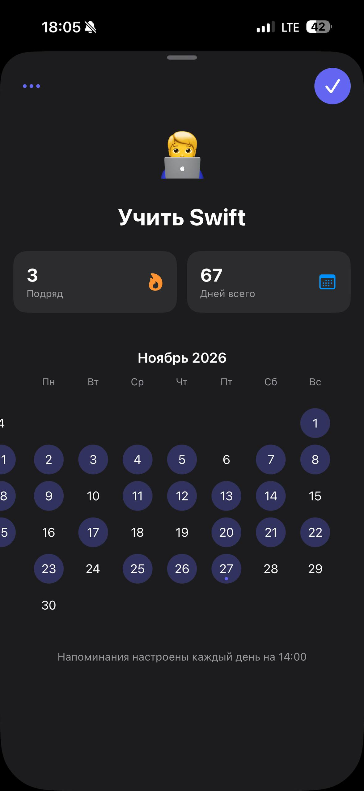
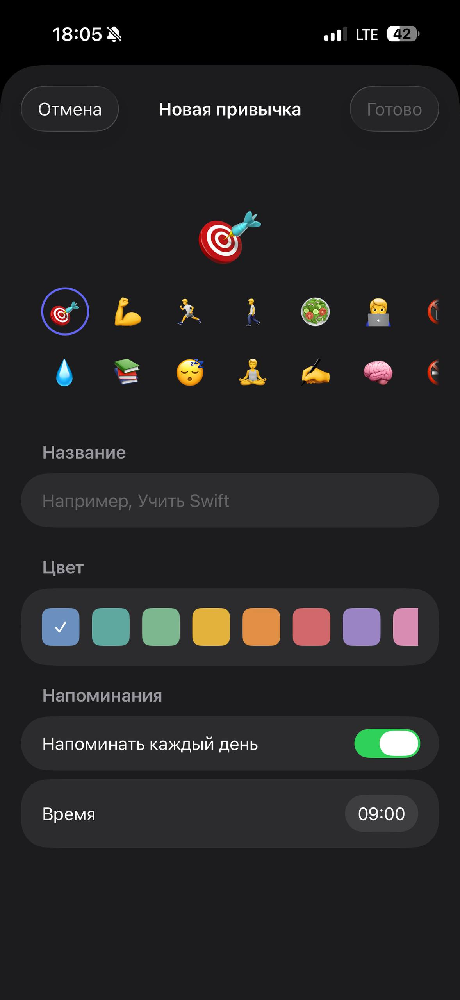
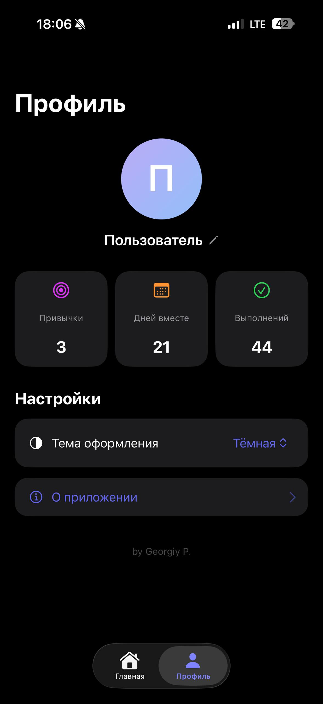

# PaceOne


Трекер ежедневных привычек для iPhone. Можно создать до трёх привычек, отмечать выполнение, просматривать историю и настраивать напоминания.

Проект для портфолио iOS-разработчика. Версия 1.0 находится на этапе подготовки к публикации в App Store.

## Скриншоты

<p>
  
  
  
  
</p>

## Возможности

- Создание и редактирование привычек с выбором эмодзи и цвета.
- Отметка выполнения за сегодня и изменение отметок прошлых дней в календаре.
- Подсветка выполненных дней текущей недели на главном экране.
- Подсчёт текущей серии и общего количества выполненных дней для каждой привычки.
- Ежедневные локальные напоминания с выбранным временем и подсказкой при запрете уведомлений.
- Статистика профиля: текущие привычки, календарные дни с первого запуска и сумма выполнений по текущим привычкам.
- Редактирование никнейма, светлая, тёмная и системная темы оформления.
- Хаптики при выполнении привычки, отмене отметки и других действиях.

Основные функции работают без интернета. Регистрация не требуется; данные сохраняются на устройстве. Рекламы, покупок и собственной облачной синхронизации в текущей версии нет.

## Технологии

| Технология | Использование |
| --- | --- |
| Swift, SwiftUI | Интерфейс и логика приложения |
| Observation, `@Observable` | Обновление интерфейса при изменении состояния |
| Foundation, `Calendar`, `Date` | Календарь, текущая неделя и серии выполнений |
| `Codable`, `UserDefaults` | Сохранение привычек и настроек |
| UserNotifications | Локальные напоминания и проверка разрешений |
| Combine | Обработка событий смены даты, часового пояса и возвращения в приложение |

Сторонние зависимости отсутствуют.

## Устройство проекта

Экраны сгруппированы по функциям. Используется разделение на View, ViewModel, модели и общее хранилище данных.

```text
PaceOne/
├── App/                 # Точка входа и настройки оформления
├── Common/
│   ├── ContentView.swift # Вкладки и создание общих зависимостей
│   ├── Models/          # Тема оформления
│   ├── Storage/         # Привычки и дата первого запуска
│   └── CurrentDateProvider.swift
├── Features/
│   ├── Home/            # Список, создание, подробности и напоминания
│   └── Profile/         # Профиль, статистика и настройки
└── Resources/           # Цвета, иконки и Privacy manifest
```

`ContentView` создаёт один `HabitStore` и передаёт его в `HomeViewModel` и `ProfileViewModel`. Главная и профиль работают с одним списком привычек: изменение отметки обновляет и карточку, и статистику.

`HomeViewModel` управляет созданием, изменением, удалением и выполнением привычек. `ProfileViewModel` вычисляет показатели профиля и сохраняет никнейм. `NotificationManager` работает с локальными уведомлениями. Состояние открытых окон и режима редактирования также используется во View.

## Несколько решений в реализации

- **Защита истории при ошибке чтения.** Если сохранённые привычки не удалось декодировать, исходная запись не перезаписывается. Приложение показывает ошибку и блокирует изменение привычек. Автоматического восстановления повреждённых данных пока нет.
- **Текущая неделя.** Семь дней на карточке рассчитываются с понедельника по воскресенье и сопоставляются с датами выполнения. Отметки прошлой недели остаются в истории.
- **Обновление даты.** `CurrentDateProvider` реагирует на системные события смены дня и времени и возвращение приложения в активное состояние. Его используют список привычек и статистика дней использования.
- **Локальное хранение.** Массив привычек кодируется в JSON и сохраняется в `UserDefaults`. Для текущего ограничения в три привычки используется небольшой объём данных.

## Запуск

Проект разрабатывается в Xcode 26.0.1. Минимальная поддерживаемая система — iOS 26.0, целевое устройство — iPhone.

1. Склонируйте репозиторий и откройте `PaceOne.xcodeproj` в Xcode.
2. Выберите схему `PaceOne` и симулятор iPhone с iOS 26.0 или новее.
3. Запустите приложение: **Product → Run** (`⌘R`).
4. Для запуска на физическом iPhone выберите свою команду в **Target PaceOne → Signing & Capabilities → Team** и проверьте уникальность Bundle Identifier для своей копии проекта.

Для основных функций не нужны API-ключи или сервер. Уведомления проверяйте на физическом устройстве: включите напоминание для привычки, разрешите уведомления и переведите приложение в фон.

## Проверка и ограничения

Ручная проверка интерфейса выполнялась на iPhone SE (3-го поколения), iPhone 13 mini, iPhone 16 и iPhone 17 Pro Max. В ходе проверки исправлялись прокрутка палитры и размещение кнопок подробностей на небольшом экране. Автоматических тестов в репозитории пока нет.

Текущая версия поддерживает до трёх привычек и портретную ориентацию. Размер текста в интерфейсе зафиксирован. Собственного экспорта, синхронизации между устройствами и восстановления истории через сервер нет.

## Документы и поддержка

- [Политика конфиденциальности](https://zatakeeey.github.io/PaceOne/privacy-policy.html)
- [Страница поддержки](https://zatakeeey.github.io/PaceOne/support.html)
- Email: [zatakey222@gmail.com](mailto:zatakey222@gmail.com)
